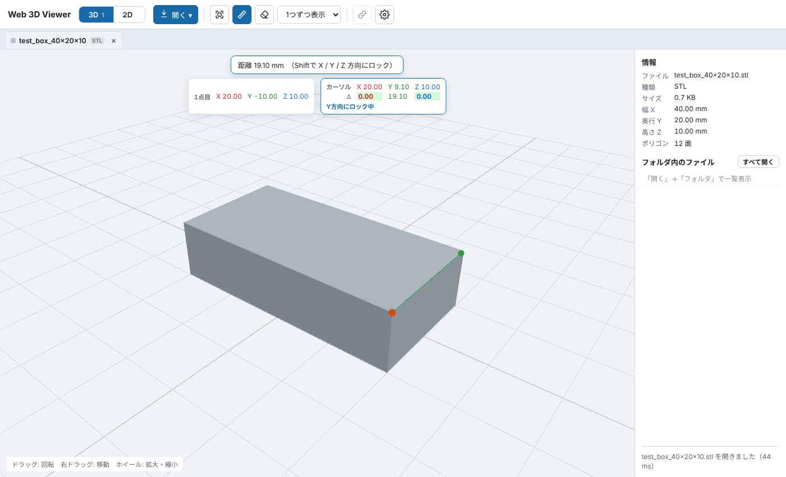
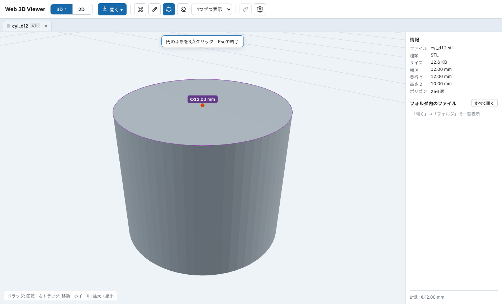

[日本語](README.md) | English

# Web 3D Viewer

A lightweight local viewer for Windows that lets you quickly open STL / 3MF (3D) and DXF / DWG / SVG (2D) files in one place. Open files from File Explorer with a right-click or double-click; additional files open as tabs in the same window.



> The application UI is currently in Japanese. The screenshots show the Japanese UI.

## Features

- Automatically routes 3D (STL / 3MF) and 2D (DXF / DWG / SVG) files. Switch between 3D and 2D, and view multiple files in tabs.
- Launch with **Open with Web 3D Viewer** from the right-click menu or by double-clicking a file. Subsequent files are added as tabs in the same window.
- **Measure distances** (ruler button / `M`):
  - 3D: snaps to corners (green) and edges (blue). Click a circular edge (purple) to show its diameter (Φ).
  - Hold **Shift** to lock measurement along the X, Y, or Z axis.
  - After selecting the first point, its coordinates and the cursor coordinates and differences (Δ) are shown in real time. Axes with a zero difference are highlighted in green.
  - 2D: snaps to line endpoints and midpoints (DXF / DWG). SVG measurements use millimeters when the SVG specifies millimeter units.
- Toggle layer visibility (DXF / DWG); show width, depth, and height for 3D models.
- Open folders, drag and drop files, or paste with `Ctrl+V`.
- Open files through `web3d://open?path=...` links (for example, links to files shared in chats or AI tools).
- Change the color around the viewer; the setting is saved in the browser.
- View-only (no editing); data is not sent externally.



## Why it uses Python instead of an EXE

When Windows 11 **Smart App Control (SAC)** is enabled, unsigned custom EXE files may be blocked. This tool uses a Python script launched by the signed `pythonw.exe`, so it can be used while SAC remains enabled.
The launcher uses only the Python standard library. It does not use `ctypes`, which SAC may also block.

## Requirements

- Windows 10 / 11
- [Python 3](https://www.python.org/) (the python.org distribution, with `pythonw.exe` available)
- [Node.js](https://nodejs.org/) (only needed to build from source; not needed for the ZIP)
- A browser such as Edge or Chrome

## Installation (easy: ZIP)

1. Download `Web_3D_Viewer-vX.Y.Z.zip` from [Releases](https://github.com/Wendi-Notes/web-3d-viewer/releases) and extract it
2. Move the `Web_3D_Viewer` folder to where you want to keep it (e.g. `C:\Web_3D_Viewer`).
   Registration uses that location, so **move it first**. If you move it later, register again
3. **Double-click `登録.pyw`** (see registration below)

The ZIP does not bundle the CAD fonts, so DXF / DWG text fonts are loaded from the internet (jsDelivr) when needed.

## Installation (build from source)

```bat
git clone https://github.com/Wendi-Notes/web-3d-viewer.git C:\Web_3D_Viewer
cd C:\Web_3D_Viewer
npm install
npm run build
```

Optionally, download fonts to display DXF / DWG text offline:

```bat
npm run fonts
npm run build
```

If you do not download the fonts, they are loaded from jsDelivr over the internet when text is displayed.

Finally, double-click **`登録.pyw`** (the filename means “Register”). Administrator privileges are not required; the registration applies only to the current user.

- The **「Web 3D Viewerで開く」** (“Open with Web 3D Viewer”) right-click menu item becomes available.
- To open a file type by double-clicking it, right-click a file and select **Open with** → **Choose another app** → **Web 3D Viewer** → **Always**. Windows requires users to choose their own default apps.

To undo the registration, double-click **`登録解除.pyw`** (the filename means “Unregister”).

## Project structure

```
launcher.pyw      Launcher: starts a local server on 127.0.0.1 and opens app/ in a browser.
                  If the app is already open, passes the file to that window.
登録.pyw          Registers the right-click menu, Open with, and web3d:// protocol (HKCU).
登録解除.pyw      Undoes the registrations above.
index.html, src/  Viewer UI (three.js + mlightcad cad-simple-viewer).
app/              Output from npm run build, served by launcher.pyw.
```

## Controls

| Input | Action |
|---|---|
| Drag / right-drag / mouse wheel | 3D: rotate / pan / zoom; 2D: pan / — / zoom |
| `F` | Fit the model or drawing in view |
| `M` | Start / stop measuring (`Esc` also stops) |
| `Shift` (while measuring) | Lock to the X, Y, or Z axis |
| `Ctrl+O` | Open a file |

## Known limitations

- DWG reading uses LibreDWG, so newer formats or large DWG files may fail to open or take a long time.
- Automatic circle detection works only for circles whose edge forms one continuous loop; coarse cylinders may not be detected.
- 2D measurement is provided by the drawing engine, so Shift axis locking is available only in 3D.

## License

**GPL-3.0-or-later** ([LICENSE](LICENSE))

The app is distributed under GPL-3.0 because it uses LibreDWG, which is GPL-3.0, to read DWG files.
You may modify and redistribute it, but you must also publish the source when distributing it. See [THIRD_PARTY.md](THIRD_PARTY.md) for the libraries used.

---

Feel free to fork and modify the project. Issues and pull requests are welcome.
