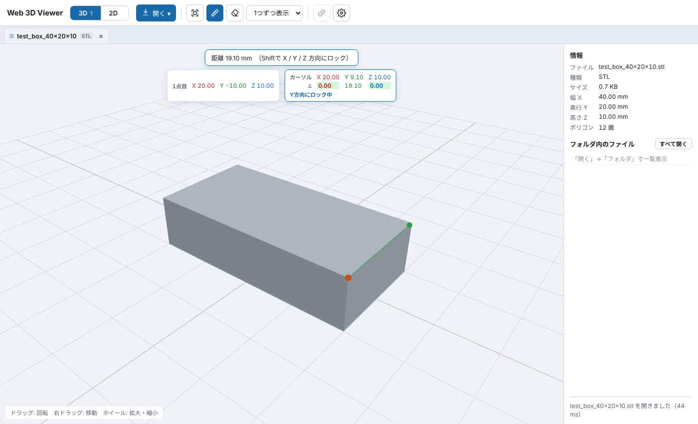
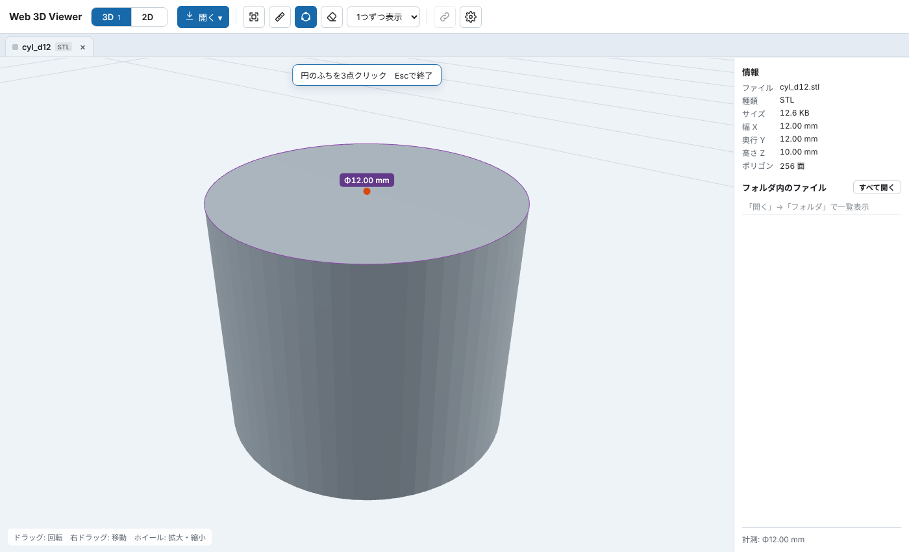

# Web 3D Viewer

STL / 3MF（3D）と DXF / DWG / SVG（2D）を、**ひとつのビューアーで**サッと開いて見るための Windows 用ローカルツールです。
エクスプローラーの右クリックやダブルクリックで開き、開いているウィンドウにタブで追加されていきます。



## できること

- **3D（STL / 3MF）と 2D（DXF / DWG / SVG）を自動で振り分け**。上の「3D / 2D」で切り替え、それぞれタブで複数表示
- **右クリック「Web 3D Viewerで開く」／ダブルクリック**で起動。2つ目以降は同じウィンドウにタブ追加
- **長さの計測**（定規ボタン / `M`）
  - 3D：角（緑）・辺（青）に吸着。**円のふち（紫）でクリックすると直径 Φ** を表示
  - **Shift を押しながら**で X / Y / Z 方向にまっすぐロック
  - 1点目を選ぶと、1点目とカーソルの座標・差（Δ）をリアルタイム表示（差が 0 の軸は緑）
  - 2D：線の端点・中点に吸着（DXF / DWG）、SVG は mm 単位が書かれていれば mm で表示
- **レイヤーの表示切り替え**（DXF / DWG）、3D は幅・奥行・高さを表示
- フォルダを開く・ドラッグ＆ドロップ・`Ctrl+V` で貼り付け
- `web3d://open?path=...` リンクで開ける（チャットや AI ツールにファイルへのリンクを貼る用途）
- 枠まわりの色を変更（設定はブラウザに保存）
- 表示専用（編集機能なし）・**データは外部に送信しません**



## なぜ exe ではなく Python で起動するのか

Windows 11 の **スマートアプリコントロール（SAC）** がオンだと、署名のない自作 exe は実行できません。
このツールは、起動役を **署名済みの `pythonw.exe` で動く Python スクリプト**にしているので、SAC をオンにしたままで使えます。
（Python 標準ライブラリのみ使用。`ctypes` も SAC に止められる場合があるため使っていません）

## 必要なもの

- Windows 10 / 11
- [Python 3](https://www.python.org/)（python.org 版。`pythonw.exe` が使えること）
- [Node.js](https://nodejs.org/)（組み立てのときだけ）
- Edge / Chrome などのブラウザ

## インストール

```bat
git clone https://github.com/Wendi-Notes/web-3d-viewer.git C:\Web_3D_Viewer
cd C:\Web_3D_Viewer
npm install
npm run build
```

（任意）DXF / DWG の文字をオフラインでも表示したい場合はフォントを取得します：

```bat
npm run fonts
npm run build
```

フォントを取得しない場合は、文字の表示時にインターネット（jsDelivr）からフォントを読み込みます。

最後に **`登録.pyw` をダブルクリック**します（管理者権限は不要、このユーザーだけに登録）。

- 右クリック →「Web 3D Viewerで開く」が使えるようになります
- ダブルクリックで開きたい拡張子は、右クリック →「プログラムから開く」→「別のプログラムを選択」→「Web 3D Viewer」→「常に使う」
  （Windows の仕様で、既定のアプリはユーザー自身が選ぶ必要があります）

取り消すときは `登録解除.pyw` をダブルクリックしてください。

## 構成

```
launcher.pyw      起動役：127.0.0.1 でローカルサーバーを立ててブラウザで app/ を開く。
                  すでに開いていれば、そのウィンドウにファイルを渡す
登録.pyw          右クリックメニュー・「プログラムから開く」・web3d:// を登録（HKCU）
登録解除.pyw      上記の取り消し
index.html, src/  画面（three.js ＋ mlightcad cad-simple-viewer）
app/              npm run build の出力（launcher.pyw が配信）
```

## 操作

| 操作 | 内容 |
|---|---|
| ドラッグ / 右ドラッグ / ホイール | 3D：回転 / 移動 / 拡大縮小　2D：移動 / ― / 拡大縮小 |
| `F` | 全体表示 |
| `M` | 計測の開始 / 終了（`Esc` でも終了） |
| `Shift`（計測中） | X / Y / Z 方向にロック |
| `Ctrl+O` | ファイルを開く |

## 既知の制限

- DWG の読み込みは LibreDWG を使っているため、新しい形式や大きな DWG では開けない・時間がかかる場合があります
- 円の自動検出は、ふちが 1 周つながった輪になっている円のみ（粗い円柱などは検出できないことがあります）
- 2D の計測は図面エンジン側の機能なので、Shift ロックは 3D のみ

## ライセンス

**GPL-3.0-or-later**（[LICENSE](LICENSE)）

DWG の読み込みに GPL-3.0 の LibreDWG を使っているため、全体を GPL-3.0 で公開しています。
改造・再配布は自由ですが、配布するときはソースも公開してください。使用しているライブラリは [THIRD_PARTY.md](THIRD_PARTY.md) を参照。

---

自由にフォーク・改造してください。Issue / Pull Request も歓迎です。
